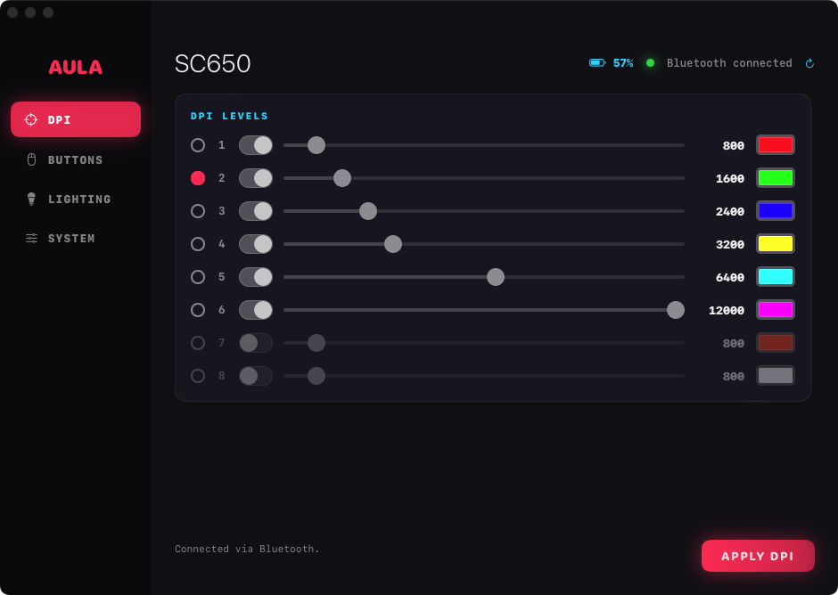
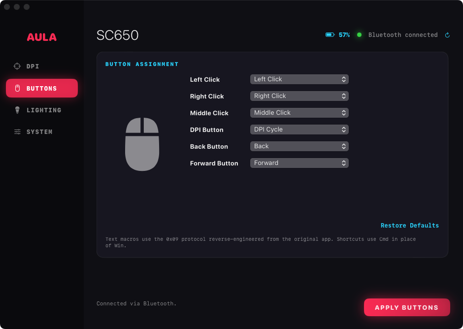
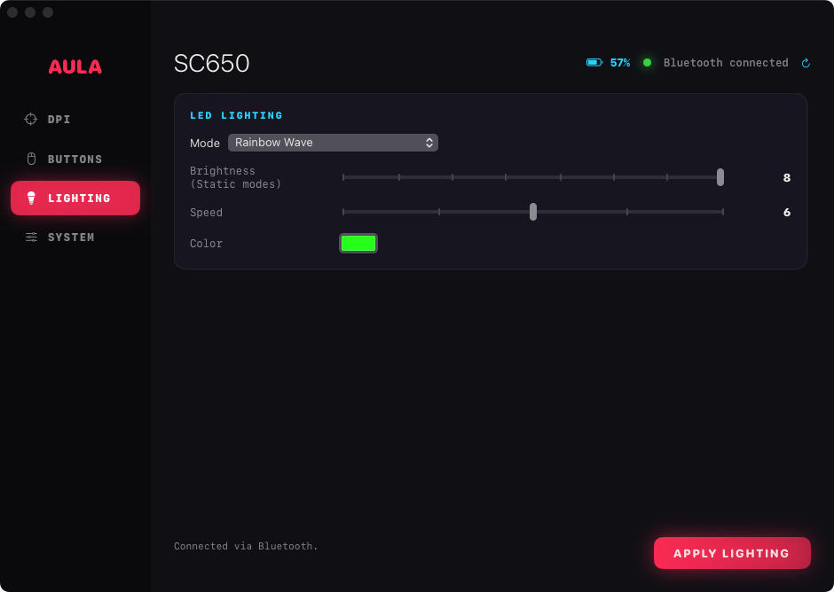
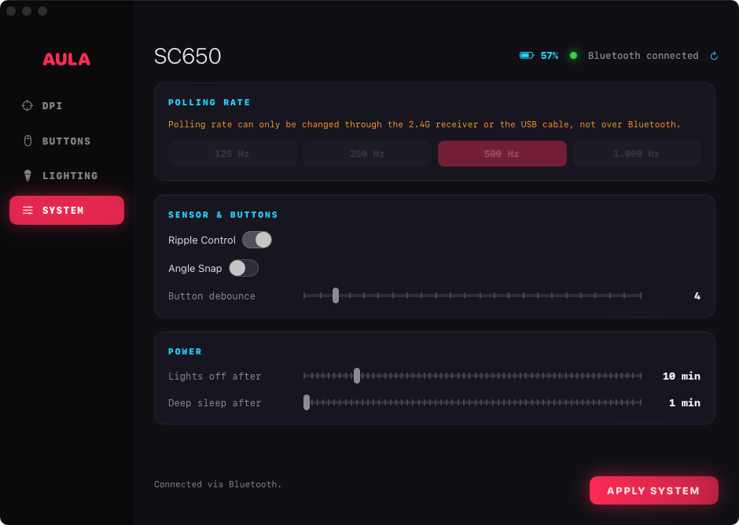

# AULA SC650 for Mac

A native macOS app (SwiftUI, dark gaming theme) to configure the **AULA SC650** gaming mouse over the **2.4G receiver** and **Bluetooth LE**.
The official software is Windows-only; this is an independent, reverse-engineered alternative.

<p align="center">
  
  
  
  
</p>

## Features

| | |
|---|---|
| **DPI** | 8 levels (50 to 12000), per-level color, current level |
| **Buttons** | Reassign left, right, middle, DPI, back and forward buttons to 50+ functions, custom shortcuts (Ctrl/Shift/Opt/Cmd + key) or type-text macros |
| **Lighting** | 12 LED modes, color, brightness, speed |
| **System** | Polling rate (125 to 1000 Hz), Ripple Control, Angle Snap, button debounce, lights-off and sleep timers |
| **Status** | Battery level and connection type, live |
| **CLI** | `aulactl` to send packets from the terminal |

Settings are stored locally: the mouse has no read-back command, so the app remembers what you last applied.

## Install

Download `AULA-SC650.dmg` from the Releases page, drag the app to Applications.
The app is ad-hoc signed (no Apple Developer ID), so the first time use **right-click > Open**.
If macOS still blocks it: `xattr -dr com.apple.quarantine "/Applications/AULA SC650.app"`.

**Bluetooth:** macOS asks for Bluetooth access on first launch. Click **Allow**.

Requires macOS 13 or later, Apple Silicon or Intel (build from source for Intel).

### Build from source

```bash
git clone <this repo> && cd aula-mac
swift test                 # unit tests
./scripts/package.sh       # builds dist/AULA SC650.app, .zip and .dmg
```

Optional: to show the real product picture in the Buttons tab, extract it from the official installer you downloaded
(`brew install innoextract`, then `./scripts/fetch-mouse-image.sh "AULA-SC650 Setup.exe"`).
The picture is the vendor's artwork and is deliberately not included in this repository.

## Usage

1. Switch the mouse to **2.4G** (receiver plugged in) or **Bluetooth** (paired in System Settings).
2. Open the app. The header shows the connection and battery.
3. Change settings and press **APPLY** on that tab. The mouse acknowledges every packet and the app reports the result.

Connection order: a Bluetooth mouse that is already connected, then the 2.4G receiver or USB cable, then a Bluetooth scan.
If you switch the mouse mode while the app is open, press the refresh button in the header.

**Polling rate is not available over Bluetooth.** The original Windows app never sends it over Bluetooth either.

At least one button must stay assigned to Left Click (the original app has the same rule), so you cannot lock yourself out.

### Command line

```bash
swift run aulactl list                 # connected AULA interfaces
swift run aulactl send-light 7         # lighting mode (7 = Rainbow Wave)
swift run aulactl send-rate 1000       # polling rate (receiver only)
swift run aulactl send-dpi             # vendor default DPI profile
swift run aulactl send-buttons         # vendor default button table
swift run aulactl send-macro hello     # upload a type-text macro to slot 0
```

## How it works

- **Receiver / USB:** 64-byte HID feature reports (`IOHIDDevice`), acknowledged by an input event.
- **Bluetooth:** macOS exposes no feature report, so the app writes the same packets to a vendor GATT characteristic (`FEE3`) and
  listens on `FEE4` (CoreBluetooth).
- Packet formats were recovered from the official Windows app and are documented in [docs/PROTOCOL.md](docs/PROTOCOL.md).

```
Sources/AulaKit   protocol, packet builders, HID and Bluetooth transports (library)
Sources/AulaApp   SwiftUI app
Sources/aulactl   command line tool
Tests             packet encoding tests
```

## Status

Tested on one SC650 (macOS 14, Apple Silicon).

| | Receiver 2.4G | Bluetooth LE | USB cable |
|---|:-:|:-:|:-:|
| Lighting, DPI, buttons, macros | works | works | untested |
| Polling rate | works | not supported by the mouse protocol | untested |
| Ripple Control, Angle Snap | sent, effect not independently verified | same | untested |

Macros only support lowercase a-z, 0-9 and space. Other SC650 hardware revisions may behave differently.
Please open an issue with the output of `aulactl list` if something does not work.

## Disclaimer

This is an unofficial project, not affiliated with or endorsed by AULA. "AULA" and "SC650" are trademarks of their owners.
The app only changes user settings (the same ones the official app changes) and never touches firmware, but you use it at your own risk.
It was written for interoperability, by analysing a copy of the official software that the author had downloaded.

## License

[MIT](LICENSE)
